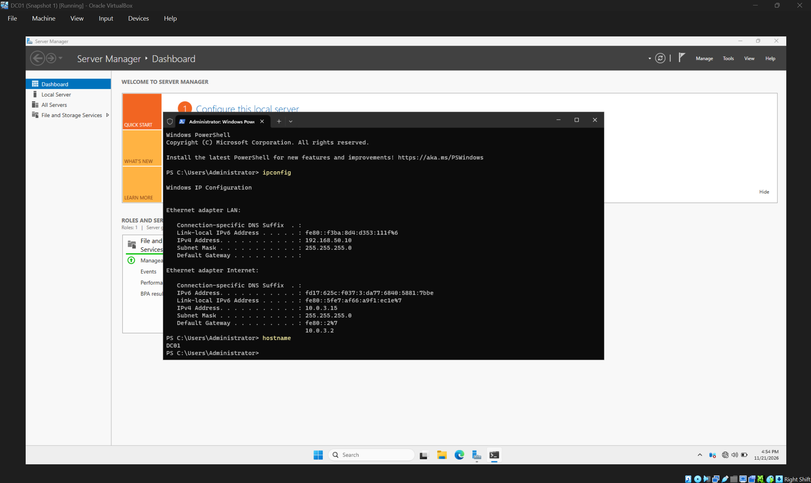
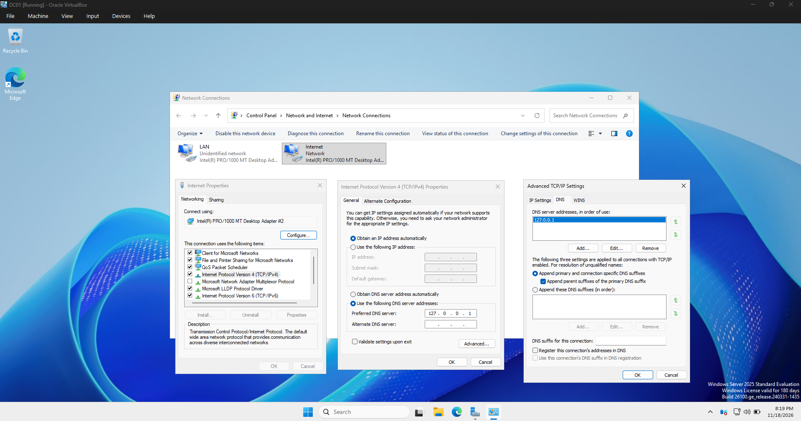
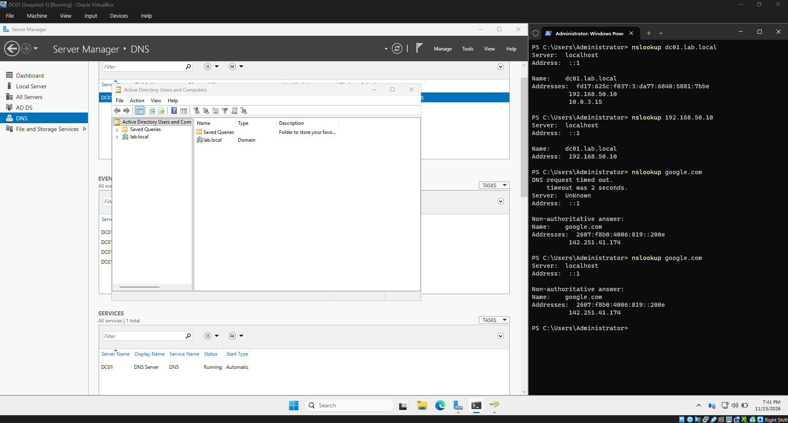
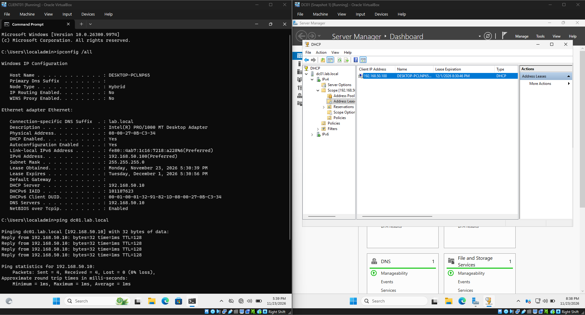
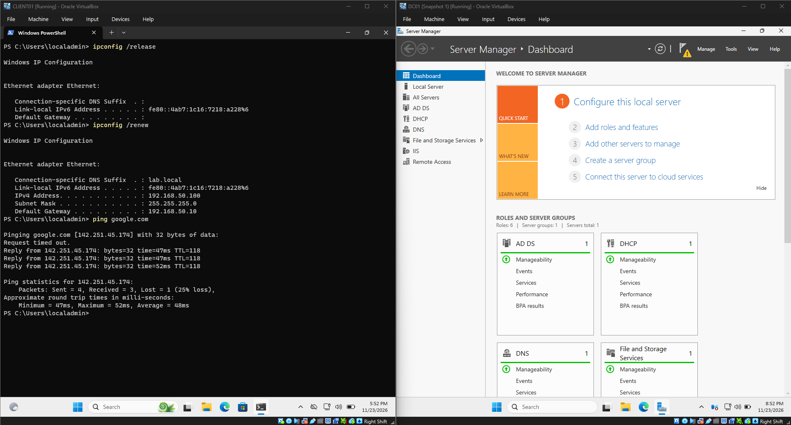
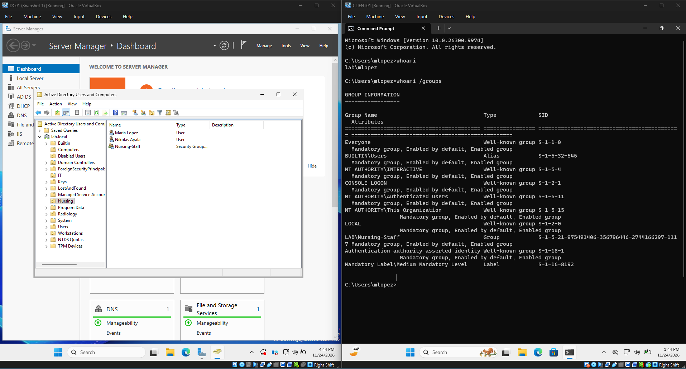
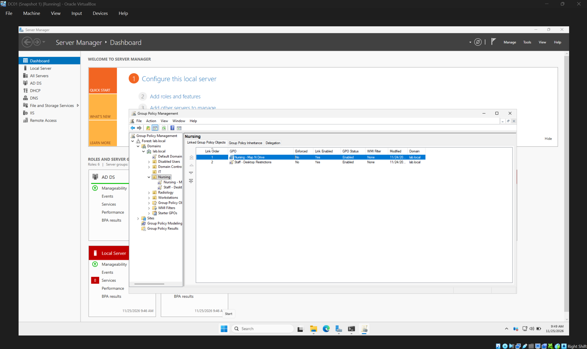
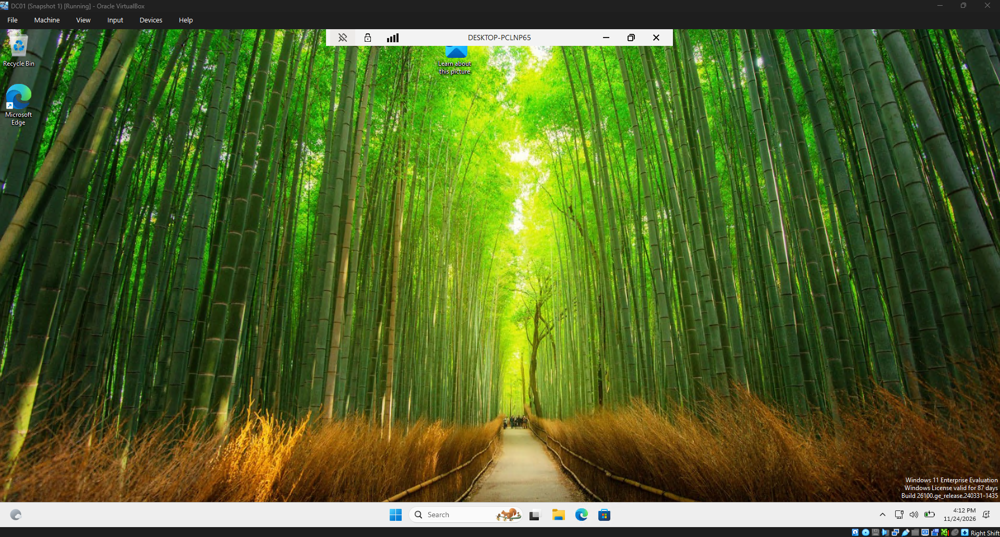

# Project 1: Windows Server domain lab
## Topics covered: Active Directory, DNS, DHCP, Group Policy, Software Deployment, Remote Desktop

Simulated hospital IT environment built to practice desktop support and
systems administration: Active Directory, DNS, DHCP, Group Policy, and
remote support.

## Note
Access my Group Policy Object report and my Group Policy results through my website www.nikdevelops.com. It's at the bottom of the webpage. 

## Environment
| VM | OS | Role | IP |
|---|---|---|---|
| DC01 | Windows Server 2025 | Domain controller, DNS, DHCP, NAT | 192.168.50.10 (static) |
| CLIENT01 | Windows 11 Enterprise | Domain workstation | DHCP |

## What I built

### 1. Virtual machines and networking

DC01 has two network adapters: a LAN adapter with a static IP of 192.168.50.10 on the private lab network, and an Internet adapter that gets its address from VirtualBox NAT. `hostname` confirms the server is named DC01.

The Internet adapter uses DC01 itself (127.0.0.1) for DNS, and "Register this connection's addresses in DNS" is turned off so the server doesn't add its NAT address to the domain's DNS.

### 2. Active Directory and DNS

After promoting DC01 to a domain controller, the lab.local domain appears in Active Directory Users and Computers and the DNS Server service is running. `nslookup` confirms forward lookup (dc01.lab.local), reverse lookup (192.168.50.10), and internet name resolution through DNS forwarders (google.com).

### 3. DHCP

The Windows 11 client received 192.168.50.100 from the DHCP server on DC01, along with DNS server 192.168.50.10 and the lab.local domain suffix. The lease appears in the DHCP console, and the client can reach DC01 by name.

After setting up DC01 as a NAT router and adding it as the default gateway in DHCP, the client renewed its lease (`ipconfig /release` and `/renew`) and reached the internet through DC01.

### 4. Domain join, users, and groups

The Nursing OU contains department users and the Nursing-Staff security group. On the client, `whoami` and `whoami /groups` show a domain user (lab\mlopez) signed in with Nursing-Staff membership.

### 5. Group Policy

Two GPOs are linked to the Nursing OU: one maps the N: drive to the Nursing share, and one applies desktop restrictions such as blocking Control Panel.

### 6. Remote Desktop

A Remote Desktop session from DC01 to the Windows 11 client, used to support the workstation remotely.
